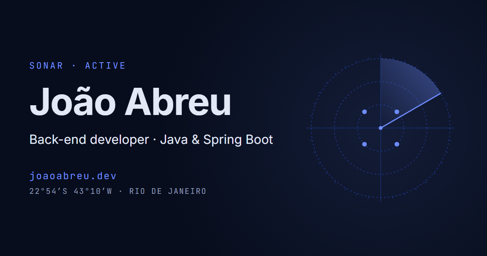

# Portfolio

[](https://github.com/jg-abreu/portfolio/actions/workflows/deploy.yml)
[](https://joaoabreu.dev)


[](LICENSE)

My personal portfolio: sonar-themed, bilingual (EN/PT) and alive with real GitHub data. Built with Astro and served from my own server.

**Live at [joaoabreu.dev](https://joaoabreu.dev)** · [Português](https://joaoabreu.dev/pt/)

[](https://joaoabreu.dev)

## Why this project

A portfolio is the first thing a recruiter opens, so it has to show the essentials on the first screen and load instantly. It is also a project in itself: a static site on a Linux server with nginx behind Cloudflare, published by a GitHub Actions pipeline on every merge, and the site explains that pipeline in its own section.

## Features

- **Sonar theme** — projects appear as contacts on a radar, placed by how recently each repository was pushed; every section has a sticky sonar display whose dot-matrix icon assembles as you scroll.
- **Live GitHub data, never fake** — contributions, repositories and a year heatmap are fetched in the browser (30-minute cache) on top of a snapshot taken at build time, so the page is complete even if the API is down. LeetCode stats come from the build.
- **Bilingual** — English by default and Portuguese (`/en/`, `/pt/`), with `hreflang`, per-language Open Graph images and locale-aware dates and numbers. English defines the shape of every string; the build fails if Portuguese diverges.
- **Case study** — a full write-up of the tutoring management system: problem, design decisions, trade-offs.
- **"How this site reaches you"** — the real deploy pipeline, from commit to browser, with a sonar ping travelling between the stages.
- **Fast and accessible** — static HTML, JavaScript only where something moves, animations on `transform`/`opacity` only and off with `prefers-reduced-motion`. Lighthouse on the live site: 97–100 in Performance and 100 in Accessibility, Best Practices and SEO.

## How it is deployed

```
merge to main · daily 06:00 (Rio) · manual run
  → GitHub Actions: npm ci → npm run build (fresh GitHub snapshot)
  → rsync over SSH as a deploy user without sudo (pinned host key)
  → AWS Lightsail · Ubuntu 24.04 · nginx (cache rules, security headers)
  → Cloudflare: DNS, CDN, HTTPS Full (strict) with an origin certificate
  → your browser
```

Server setup, from an empty instance to HTTPS, is documented step by step in [`deploy/README.md`](deploy/README.md); the nginx site is [`deploy/nginx/portfolio.conf`](deploy/nginx/portfolio.conf) and the pipeline is [`.github/workflows/deploy.yml`](.github/workflows/deploy.yml).

## Tech stack

| Layer | Technologies |
|---|---|
| Front-end | Astro 7, TypeScript (strict), content collections, self-hosted Inter and JetBrains Mono |
| Data | GitHub REST API, GitHub contributions mirror, LeetCode GraphQL (build only) |
| Infrastructure | AWS Lightsail (Ubuntu 24.04), nginx, Cloudflare, GitHub Actions, rsync over SSH |

## Running locally

Requires [Node.js](https://nodejs.org/) 22.22 or newer.

```bash
git clone https://github.com/jg-abreu/portfolio.git
cd portfolio
npm install
npm run dev
```

Then open **http://localhost:4321** (it redirects to `/en/`).

| Command | What it does |
|---|---|
| `npm run dev` | Starts the dev server |
| `npm run build` | Fetches the GitHub snapshot, type-checks (`astro check`) and builds the static site into `dist/` |
| `npm run preview` | Serves the built site locally |
| `npm run og` | Renders the share images in `public/og/` with headless Chrome |

Set `GITHUB_TOKEN` before building for a higher GitHub API rate limit (the deploy workflow does this).

## Project structure

```
src/
  content/            projects, case study, about, stack and contacts, per language
  components/         radar scope, sonar displays and icons, heatmap, deploy pipeline
  lib/                content checks, GitHub data validation, radar and activity math
  scripts/            browser islands: live GitHub data, sonar displays, scroll effects
  i18n/ui.ts          UI strings per language
  pages/              home and case study per language, 404
scripts/              build-time GitHub snapshot and share image rendering
deploy/               server documentation and nginx config
public/               favicons, share images, robots.txt
```

## Built with Claude Code

The code and configuration files are written with [Claude Code](https://claude.com/claude-code), following the public rules in [`CLAUDE.md`](CLAUDE.md). The server itself (instance, SSH, users, nginx, Cloudflare, secrets) was set up by hand, one command at a time.

## License

Released under the [MIT License](LICENSE).

## Author

**João Abreu** — back-end developer and Computer Science student in Rio de Janeiro, Brazil.

[Website](https://joaoabreu.dev) · [GitHub](https://github.com/jg-abreu) · [LinkedIn](https://www.linkedin.com/in/jo%C3%A3o-abreuuu) · jgabreudev@gmail.com
