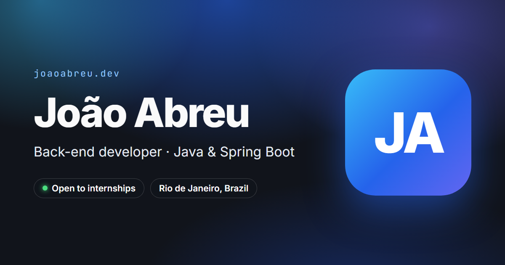

# Portfolio

[](https://github.com/jg-abreu/portfolio/actions/workflows/deploy.yml)
[](https://joaoabreu.dev)


[](LICENSE)

Explore my Java backend projects, read their case studies and download my résumé in English or Portuguese at [joaoabreu.dev](https://joaoabreu.dev). The Astro site uses a Spring Boot API for its AI assistant and admin tools. Both run on AWS Lightsail.

**Live at [joaoabreu.dev](https://joaoabreu.dev)** · [Português](https://joaoabreu.dev/pt/) · Lighthouse 97–98 Performance and 100 Accessibility, Best Practices and SEO on the audited pages

[](https://joaoabreu.dev)

## Contents

- [Features](#features)
- [How it is deployed](#how-it-is-deployed)
- [Tech stack](#tech-stack)
- [Running locally](#running-locally)
- [Backend API, endpoints and tests](api/README.md)
- [Project structure](#project-structure)

## Features

- **Live GitHub data, never fake**: contributions, repositories and a year heatmap are loaded in the browser on top of a snapshot taken at build time, so the page is complete even if the GitHub API is down. An algorithm practice section links to my solutions and profiles.
- **Bilingual**: English and Portuguese (`/en/`, `/pt/`), with `hreflang`, per-language share images and locale-aware dates and numbers. The build fails if the Portuguese strings drift from the English ones.
- **Ask about João**: an AI assistant that answers questions about me in either language, using only an approved knowledge base ([details](docs/assistant.md)).
- **Blog**: my [DEV](https://dev.to/joao_abreu) articles are fetched at build time and rendered as static pages, with unsafe Markdown, scripts and images filtered out ([details](docs/blog.md)).
- **Projects**: a page for each project, managed from the admin and published as static pages.
- **Recommendations**: books and other picks, with covers from Google Books ([details](docs/recommendations.md)).
- **Contact and visits**: a contact form whose messages are saved before the visitor gets a confirmation, and an approximate visit counter that stores no IP addresses ([contact](docs/contact.md), [visits](docs/visits.md)).
- **Private admin**: GitHub sign-in to edit projects, recommendations and my GitHub profile card without touching code. Publishing a change queues a rebuild of the static site ([details](docs/publication.md)).
- **"How this site reaches you"**: the real deploy pipeline explained on the site itself, from commit to browser.
- **Résumés in both languages**: English and Portuguese PDF résumés, matching the selected site language.
- **Fast and accessible**: static HTML, JavaScript only where something moves, light and dark themes, and animations that turn off with `prefers-reduced-motion`.

## How it is deployed

```
merge to main · daily 06:00 (Rio) · manual run
  → GitHub Actions: npm ci → npm run build (fresh GitHub, DEV and content snapshots)
  → rsync over SSH as a deploy user without sudo (pinned host key)
  → AWS Lightsail · Ubuntu 24.04 · nginx (cache rules, security headers)
  → Cloudflare: DNS, CDN, HTTPS Full (strict) with an origin certificate
  → your browser
```

Server setup, from an empty instance to HTTPS, is documented step by step in [`deploy/README.md`](deploy/README.md); the nginx site is [`deploy/nginx/portfolio.conf`](deploy/nginx/portfolio.conf) and the pipeline is [`.github/workflows/deploy.yml`](.github/workflows/deploy.yml). The API runs on the same server, behind the same nginx; see [`api/PRODUCTION.md`](api/PRODUCTION.md).

## Tech stack

| Layer | Technologies |
|---|---|
| Front-end | Astro 7, TypeScript (strict), content collections, self-hosted Inter and JetBrains Mono |
| Back-end | Spring Boot API in [`api/`](api/) for the admin, contact, visits, assistant and published content |
| Data | GitHub REST API and contributions, DEV API (build only), Google Books |
| Infrastructure | AWS Lightsail (Ubuntu 24.04), nginx, Cloudflare, GitHub Actions, rsync over SSH |
| Testing | Node's built-in test runner, `astro check` |

## Running locally

Requires [Node.js](https://nodejs.org/) 22.22 or newer.

```bash
git clone https://github.com/jg-abreu/portfolio.git
cd portfolio
npm install
npm run dev
```

Then open **http://localhost:4321** (it redirects to `/en/`). The public pages work without the API; the admin, assistant, contact form and visit counter need the API in [`api/`](api/) running locally (see its README).

| Command | What it does |
|---|---|
| `npm run dev` | Starts the dev server |
| `npm test` | Runs the test suite |
| `npm run build` | Fetches the snapshots, type-checks (`astro check`) and builds the static site into `dist/` |
| `npm run preview` | Serves the built site locally |
| `npm run og` | Renders the share images in `public/og/` with headless Chrome |

Set `GITHUB_TOKEN` before building for a higher GitHub API rate limit (the deploy workflow does this). Publishing content from the API is covered in [`docs/publication.md`](docs/publication.md).

## Project structure

```
src/
  content/            projects, about, stack, contacts and practice profiles
  components/         assistant, contact form, heatmap, repositories, deploy pipeline
  lib/                content checks, GitHub data validation, activity math
  scripts/            browser islands: live GitHub data, assistant, contact, admin, pipeline
  i18n/ui.ts          UI strings per language
  pages/              home, projects, blog, recommendations, résumé, contact, admin
scripts/              build-time snapshots (GitHub, DEV, projects, recommendations), share images and tests
deploy/               server documentation and nginx config
docs/                 how each feature works
public/               favicons, share images, résumé PDFs (cv/), robots.txt
```

## Built with Claude Code

The code and configuration files are written with [Claude Code](https://claude.com/claude-code), following the public rules in [`CLAUDE.md`](CLAUDE.md). The architecture and design decisions are mine, and the server itself (instance, SSH, users, nginx, Cloudflare, secrets) was set up by hand, one command at a time.

## License

Released under the [MIT License](LICENSE).

## Author

**João Abreu**: back-end developer and Computer Science student in Rio de Janeiro, Brazil.

[Website](https://joaoabreu.dev) · [GitHub](https://github.com/jg-abreu) · [LinkedIn](https://www.linkedin.com/in/jo%C3%A3o-abreuuu) · jgabreudev@gmail.com
